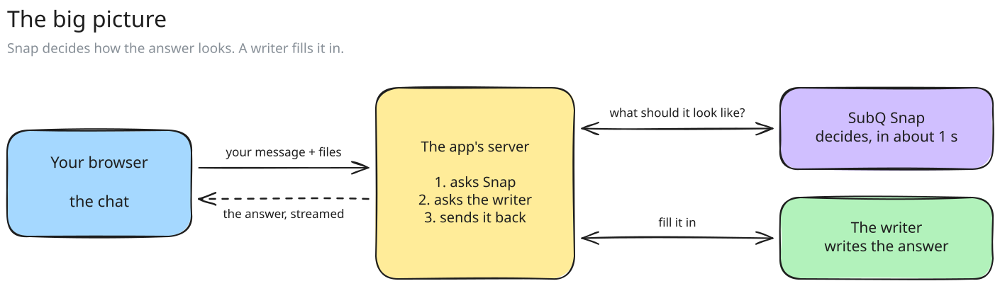
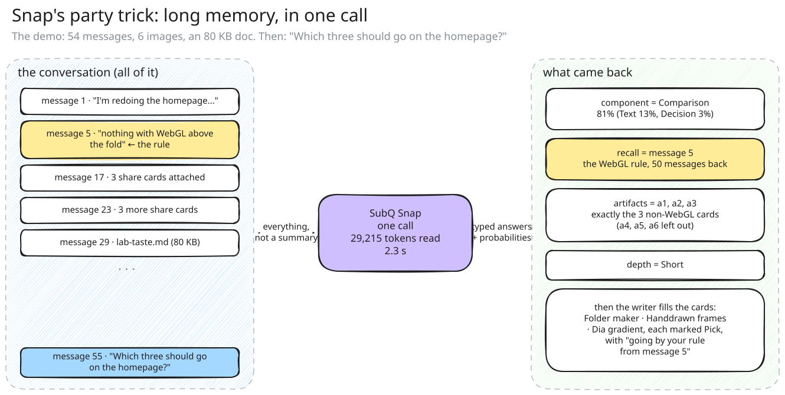
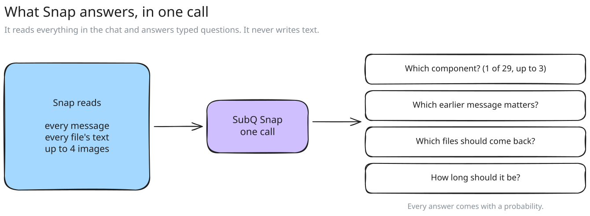
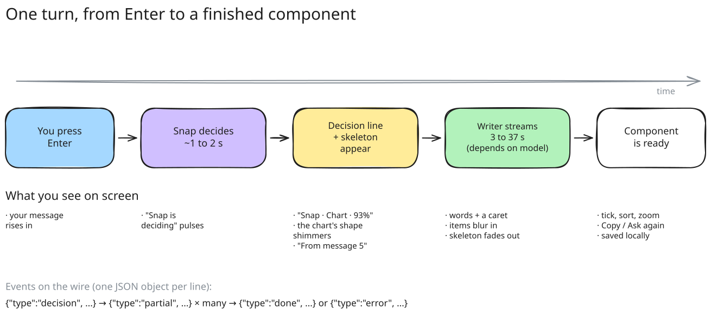
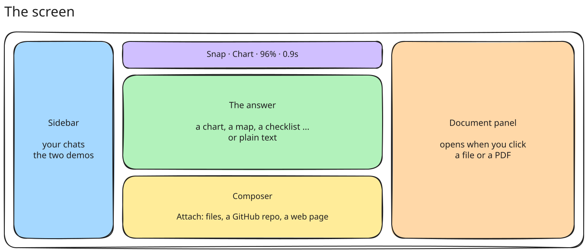
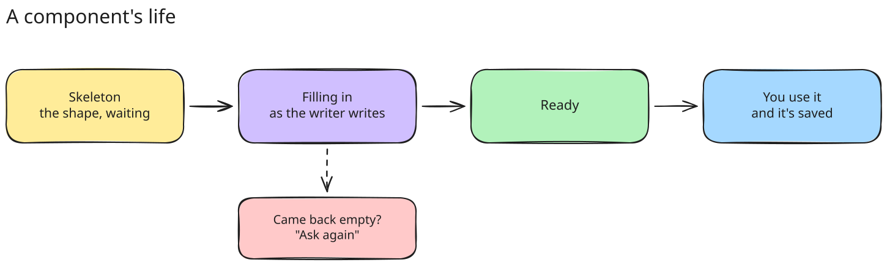

# snapshift · SubQ Snap reads the whole chat and picks how every answer looks

A chat app where **SubQ Snap** reads *everything in the conversation*, on every turn: every message, the text of
every PDF and document, spreadsheets, web pages, whole GitHub repositories, and the images themselves. From all of
it, it decides **how each answer should look**: a chart, a map, a checklist, a quiz, a recipe, or just text.
A second model, **the writer**, then fills that in. Nothing gets summarised away.



---

## TL;DR (30 seconds)

- **Snap reads all of it, every turn.** Messages, PDFs (their text), spreadsheets, web pages, repositories, and up
  to 4 images at a time, in one call, up to 384k tokens. Measured: a 164-page PDF plus a 111-file repository,
  **171k tokens, read and decided in 2 to 3.3 seconds**. Snap keeps nothing between turns: the app sends the
  whole chat again each time, and Snap reads it again.
- **Snap decides, the writer writes.** One fast Snap call picks the component (out of 29), the earlier message
  the answer depends on, which of your files to bring back, and how long to go. Then the writer fills it in.
- **It remembers.** In the demo, Snap found a rule from **message 5 of 54** and picked **exactly the right 3 of 6
  images**, in one call, in about 2 seconds.
- **More than one, when you ask for it.** "Plan a trip, map it and give me a budget" comes back as an itinerary, a
  map and a breakdown: still one Snap call (0.8 s), still one writer call.
- **Long context is real.** The **Codebase demo** puts this app's whole source in one chat: 54 files, 137k tokens.
  Snap reads all of it every turn, picks the right file and decides in about **3 seconds**. The writer is handed
  only that file.
- **Bring in a whole repository.** Attach → **A GitHub repository**, paste `owner/repo`, see how much of Snap's
  384k it takes, untick folders, add. `pmndrs/zustand` (81 files, 112k tokens): Snap decided in 2.4 s and picked
  the 2 files the answer needed. Web pages work the same way.
- **Answers are real UI.** Charts you can hover, checklists you can tick, maps you can drag, quizzes you can take.
  What you do is saved.
- **Files open on the right.** Click a PDF or doc and it slides into a side panel, like other assistants.
- **Run it:** `bun install`, add keys to `.env.local`, `bun dev`, click **Try the demo conversation**.

---

## Pick your path

| I want to... | Read | Time |
| --- | --- | --- |
| just run it | [Run it](#run-it) | 2 min |
| understand what Snap is doing and why it's good | [What Snap does here](#what-snap-does-here) | 5 min |
| see how one message turns into a chart | [One turn, step by step](#one-turn-step-by-step) | 4 min |
| know which model writes and how to switch | [The writer](#the-writer) | 2 min |
| see all 29 answer types | [The 29 components](#the-29-components) | 3 min |
| add my own component | [Add a component](#add-a-component) | 5 min |
| find a file | [Where things live](#where-things-live) | 2 min |
| fix an error | [When something goes wrong](#when-something-goes-wrong) | as needed |

---

## Run it

```bash
bun install
cp .env.local.example .env.local   # or create it, see below
bun dev                            # http://localhost:3000
```

Then click **Try the demo conversation**, and tap one of the suggested questions.

### Keys (`.env.local`)

| Variable | Needed? | What it's for |
| --- | --- | --- |
| `SUBQ_API_KEY` | **yes** | SubQ Snap, the decider. Get one at [console.subq.ai](https://console.subq.ai). |
| `OPENROUTER_API_KEY` | one writer key | The writer, using a free model. [openrouter.ai](https://openrouter.ai) |
| `GEMINI_API_KEY` | one writer key | The writer, using Gemini (faster). |
| `WRITER` | optional | `openrouter`, `gemini` or `subq`. If unset: the first key found, in that order. |
| `OPENROUTER_MODEL` / `GEMINI_MODEL` | optional | Swap the writer's model. |
| `GITHUB_TOKEN` | optional | Reading repositories works without it (public ones, 60 lookups an hour). A token raises the limit and reads private ones. |

> [!TIP]
> No credits to spare? Use OpenRouter's free model. Want it fast? Use Gemini. Want it all-SubQ? `WRITER=subq` once
> `subq-preview` access opens up for your key.

<details>
<summary><b>Other commands</b></summary>

```bash
bun run build && bun start   # production build (measure speed here, never in dev)
bun run lint                 # ESLint with the React Compiler rules
bunx tsc --noEmit            # type check
```

Open **/components** in the running app to see and try every component with sample data.

</details>

---

## What Snap does here

**Snap never writes a single word of the answer.** It is a *decision* model: you give it a state and typed
questions, and it gives back typed answers with probabilities. That turns out to be exactly what a "which UI
should this be?" layer needs.



### Every turn, one Snap call answers five things at once

| Question | Type | Example answer |
| --- | --- | --- |
| **Which component** shows this best? | choice of 29 | `comparison`, 81% |
| **Does it need more than one?** | choice of 29 + none, read as a ranking | `map` 57%, `breakdown` 32%, none 3% |
| **Which earlier message** does the answer depend on? | choice over up to 254 messages | `message 5`, 67% |
| **Which files** should come back? | yes/no for each (up to 12 files), or one ranked choice (more than 12) | `a1, a2, a3` yes; or `map.tsx` 96% of 54 files |
| **How long** should the text be? | score from 0 to 3 | `Short` |



It also answers three quick questions about **every image you attach** (what kind of image, light or dark, any
readable text), so the writer knows what a picture is even when it can't see it.

### Snap's strengths, and where you can see each one

| Strength | What it looks like in the app | Measured |
| --- | --- | --- |
| **Long context, no summarising** | It reads the whole transcript, every file's text, and up to 4 images, every single turn. The meter in the header and the decision line show how much. | **Codebase demo**: 137k tokens read, decided in 2.5 to 3 s. Measured up to 342k tokens: 4.8 s, and the right file out of 61 every time (9 of 9). |
| **Real recall** | The **"From message 5"** chip. Click it and the chat scrolls there. | Found the WebGL rule from message 5 of 54. Found the launch list in message 37. Found a 229 KB budget in message 46 without being asked. |
| **Picks the right files** | Comparison and gallery cards show exactly the images that matter. With documents, a chip names the file Snap picked, and the writer reads only that. | Picked the 3 non-WebGL share cards out of 6. Picked `map.tsx` out of 54 source files with 96%. |
| **Picks the right UI** | The decision line: `Snap · Chart · 93% · 1.2s · 1.5k tokens read` | 12 of 12 plain questions got the intended component (recipe, quiz, map, chart, draft ...), then 10 of 10 for the newest four (calculator, timer, flashcards, before & after) without stealing from their neighbours |
| **More than one component** | The decision line: `Snap · Itinerary + Map + Breakdown`, and three cards under it. | 24 of 24: all 8 questions that asked for two or three things got exactly those, and none of the 16 plain ones got an extra. No slower: about 0.8 s. |
| **Fast** | The decision line and the component's skeleton appear before the writer has written a word. | ~0.9 s on short chats, ~2 s on the 30k-token demo with images |
| **Honest confidence** | Click the decision line: every component it weighed, with its probability. | e.g. Comparison 81%, Text 13%, Decision 3% |
| **Images** | Attach a screenshot and the chip says `Snap: Screenshot, dark, text`. | One call per image, a few hundred ms |
| **No agent loop** | No tools, no "let me search". One call decides, one call writes. | 2 model calls per turn, always |

> [!NOTE]
> **What Snap doesn't do:** it doesn't write the answer, and it can't read a PDF's bytes. So the server turns
> every PDF into text first. Before that fix, Snap picked **Options at 46%** for a PDF it could only see the name
> of. After it, it picked **Tree at 80%**, because it could read the family tree inside.

### Snap vs. a normal chatbot

| | A normal chatbot | Here |
| --- | --- | --- |
| How the answer looks | always markdown text | one of 29 real components, chosen per answer |
| Old messages | summarised or forgotten | read in full, every turn |
| Your earlier files | out of sight | brought back when they matter |
| Deciding the format | the writer guesses mid-sentence | decided up front, in ~1 s, with probabilities you can see |
| Skeleton while waiting | a spinner | the actual shape of the coming answer |

<details>
<summary><b>Deep dive: the exact Snap request</b></summary>

`POST https://api.subq.ai/v1/systemone` (code: `src/lib/decide.ts`, `src/lib/subq.ts`)

```jsonc
{
  "model": "subq-snap-preview",
  "state": {
    "new_message": { "id": "m55", "text": "Which three should go on the homepage?" },
    "conversation": [ { "id": "m1", "number": 1, "role": "user", "when": "3 h ago", "text": "..." } /* every message */ ],
    "artifacts": [ { "id": "a1", "kind": "image", "name": "Folder maker.webp", "caption": "..." } ],
    "documents": [ { "id": "a7", "name": "lab-taste.md", "text": "...the whole file..." } ],
    "attached_images": "The images attached to this request are, in order: a1, a2, a3, a4."
  },
  "images": [ { "mediaType": "image/webp", "base64": "..." } ],   // up to 4
  "questions": {
    "component": { "type": "choice", "instructions": "Which interface component...", "criteria": { "text": "...", "chart": "...", /* 29 */ } },
    "recall":    { "type": "choice", "instructions": "Which single earlier message...", "criteria": { "none": "...", "m5": "user: nothing with WebGL..." } },
    "also":      { "type": "choice", "instructions": "Did the user explicitly ask for more than one kind of thing...", "criteria": { "none": "...", "map": "...", /* 28 */ } },
    "depth":     { "type": "score",  "instructions": "How long should the written part be?", "criteria": ["One line", "A short paragraph", "A detailed answer", "A thorough answer"] },
    "use_a1":    { "type": "noul",   "instructions": "Should artifact a1 be shown or used?", "criteria": { "true": "...", "false": "..." } }
  }
}
```

Things that bit us, so you don't have to find them again:

- **A choice needs at least 2 options.** On a conversation's first message there's nothing to recall, so the
  `recall` question is left out. Otherwise Snap rejects the whole call.
- **The descriptions are the product.** Snap tells components apart by their one-line descriptions in
  `src/lib/blocks.ts`. When it picks wrong, sharpen those first. (Decision and Comparison overlapped until
  Decision said "Not for choosing among several options".)
- If Snap rejects a call for having too many questions, the app asks again with fewer file questions.
- **Questions cost more than tokens.** At 130k tokens, a yes/no for each of 54 files took 5.5 s. One choice over
  the same 54 files took 1.8 s and put 96% on the right one. So above 12 files the app asks one ranked `files`
  choice instead of a yes/no each.
- **Extras need two signals.** An extra component is added when it gets at least 30% of `also` **and** `none` gets
  under 20%. With only the first rule, pros and cons also got a verdict card, and steps also got a code card:
  handy, not asked for.

</details>

---

## The two demos

| Demo | What's in it | Try | What it shows |
| --- | --- | --- | --- |
| **Demo conversation** | 54 messages, 6 images, an 80 KB document (about 30k tokens) | "Which three should go on the homepage?" | recall from 50 messages back, the right 3 images of 6 |
| **Codebase demo** | this app's own source: 54 files, 137k tokens | "Which file draws the map, and which tile server does it use?" | long context: Snap reads all 137k, picks `map.tsx`, decides in about 3 s; the writer reads one file |

The codebase is a snapshot. After changing the code: `node scripts/codebase-demo.mjs`.

---

## One turn, step by step



1. **You press Enter.** The browser sends the conversation, the text of every document, and up to 4 images
   (the ones attached now first, then the ones Snap picked last time, then the newest) to `/api/turn`.
2. **The server reads PDFs into text** (`src/lib/pdf.ts`), so Snap and every writer can read them.
3. **Snap decides** (one call). The server sends the decision to the browser **immediately**.
4. **The browser shows the decision line and a skeleton** in the chosen component's exact shape.
5. **The writer writes**, from the whole conversation and only the documents Snap picked, streaming JSON that matches the component's schema. Each chunk is parsed, even
   half-finished, and sent on, so items blur in one by one.
6. **Done.** The component becomes interactive. Ticks, answers and edits are saved to IndexedDB.

Everything travels as **NDJSON**, one JSON object per line:

```jsonc
{"type":"decision","decision":{"component":"checklist","confidence":0.92,"recall":"m37","artifacts":[],"depth":1,"ms":2100,"inputTokens":29789}}
{"type":"partial","text":"Going by your launch list...","data":{"title":"Before October 20","items":[{"text":"Homepage share image"}]}}
{"type":"done","text":"...","data":{...},"writeMs":5500,"writer":"gemini-3.6-flash"}
```

<details>
<summary><b>Deep dive: what the writer is told</b></summary>

Code: `src/lib/prompt.ts`. The writer gets:

- the full conversation as chat messages, each user message labelled `[message N]`
- documents as text, but **only the ones Snap picked** for this reply, plus any attached to the newest message.
  The rest are mentioned as "shared here, not attached". This is what lets a chat hold a whole codebase: Snap
  reads 137k tokens, the writer reads one file.
- the images Snap looked at (OpenRouter and Gemini can see them)
- Snap's decision, in plain words: the component, how long to write, the recalled message quoted in full, and
  the files Snap picked
- the component's **JSON schema**, so the reply is guaranteed to fit the component (with extra components, one
  schema each: `data`, `data_map`, `data_breakdown`)
- house rules: no hype, no em dashes, numbers in the text must match the component, give exactly as many items as
  asked for, never invent chart numbers or URLs

Rules that must hold even deep in a long conversation (like "3 questions means 3") are written into the schema's
field descriptions too. Gemini ignored them in the system prompt at 30k tokens; in the schema it listened.

</details>

---

## The writer

| Writer | Model | Speed on the 30k demo | Notes |
| --- | --- | --- | --- |
| **OpenRouter** (default when its key is set) | `dots-studio/dots-3-note-preview:free` | 25 to 37 s | Free. Sees images. Falls back to Nemotron 3 Super when busy. Free tier has a daily limit. |
| **Gemini** | `gemini-3.6-flash` | 3 to 7 s | Fast and accurate. 3.7 and 3.8 flash took 45 to 53 s for the same reply. |
| **SubQ** | `subq-preview` | not yet measured | Early access. Our key gets `403` today. |

Switch with one line in `.env.local`: `WRITER=gemini`. "How Snap decided" (click the decision line) always
says which model wrote the reply and how long it took.

**Safety nets on the server** (`src/app/api/turn/route.ts`, `src/lib/subq.ts`):

- a momentary 503 or 429 is retried once, quietly
- em dashes in anything the writer produces are replaced (number ranges keep a hyphen: 1931-2004)
- provider errors show the provider's real reason, not "Provider returned error"
- if the writer finishes without filling the component, the reply says so, with **Ask again**

---

## The 29 components

Snap chooses from these. Each has a skeleton in its own shape, copes with half-streamed data, can be copied as
plain text, and **actually does something** when you touch it.

Every one sits in the same card: a slim **top bar** with its icon, its name, a useful detail ("5 rows",
"3 questions", "hero.tsx"), its own tools, and **Copy, always in the same corner**.

| Component | Snap picks it for | You can |
| --- | --- | --- |
| Text | conversation, explanations | read |
| Comparison | choosing between options | open images full size; swipe on a phone |
| Gallery | showing shared files | open images full size; open docs in the panel |
| Timeline | history, how something evolved | fold long ones |
| Checklist | what's left, launch lists | tick items (saved) |
| Decision | a yes/no question | read the verdict, confidence and reasons |
| Table | facts across items | sort any column, copy into a spreadsheet |
| Steps | how-tos | mark steps done |
| **Chart** | numbers whose shape matters | hover or use arrow keys, hide series, switch to a table, copy data |
| Stats | headline numbers | read trends in sparklines |
| Map | places, routes | drag, zoom, open a place in Maps |
| Code | snippets, commands | copy, expand long files |
| Calendar | dates, deadlines | page months, tap days, **Add to calendar** (.ics) |
| Options | when it needs your choice | tap one (or several), or "Something else..." |
| Matrix | effort vs impact | hover items |
| Tree | folders, outlines | fold and unfold |
| Recipe | cooking | change servings (amounts scale), tick ingredients |
| Quiz | practice | answer, see why, get a score, retry |
| Itinerary | trips, schedules | switch days, open places in Maps |
| Pros & cons | is it worth it | read both sides and a verdict |
| Scorecard | rate my thing | sort weakest first |
| Draft | emails, messages | edit before copying, **Open in Mail** |
| Links | where to learn more | open, copy all |
| Rewrite | edit my text | see changes word by word |
| Breakdown | budgets, bills | split per person |
| **Calculator** | loans, splits, what-ifs | drag sliders or type values; results recompute live |
| **Timer** | countdowns, focus sessions, intervals | start, pause, skip a phase, run rounds |
| **Flashcards** | memorising | flip a card, say "Got it" or "Again", shuffle |
| **Before & after** | two versions of an image | drag the divider (or use arrow keys) to reveal |

**Charts come in 7 kinds:** line, area, bar, stacked, ranked (horizontal), pie (a donut, up to 6 slices) and
split. Colours are colour-blind checked, there's one axis from zero, and the numbers are always one tap away
as a table.

---

## The screen



- **Left sidebar:** your conversations, grouped by day. Folds away; on a phone it's a drawer.
- **The chat:** your messages on the right, answers on the left with Snap's decision line above them.
- **The right panel:** click any PDF or document and it opens here. PDFs render as real pages (zoom, page
  counter, a Text view). Markdown renders, CSV becomes a table, JSON gets colour. Drag the left edge to resize.
  Escape closes. On a phone it covers the screen.
- **Images:** click one in a message to see it full size. Arrow keys flip through.

### Bring things in

The **Attach** button opens a small menu:

| Choice | What happens | Limits |
| --- | --- | --- |
| **Files from this device** | images, PDFs, Markdown, text, CSV, JSON (drag and drop and paste work too) | 3 MB a document |
| **A GitHub repository** | paste `owner/repo` or any github.com link (a link into a folder reads just that folder). The dialog lists the files, shows **how many tokens they take against what's free in Snap's context**, and lets you tick folders and files in and out before adding. | 250 files and whatever is left of 384k tokens. Lockfiles, build output, binaries and files over 150 KB are left out. |
| **A web page** | paste a link; its text is read on the server and added as a document, after a preview | pages that need JavaScript to show anything can't be read |

- A repository that doesn't fit is trimmed for you: tests, examples and docs go first, then the heaviest folders.
  The dialog says what it left out, and you can tick it back in.
- A whole repository shows as **one chip** (`pmndrs/zustand · 81 files · 116k tokens`) that unfolds to its files.
- After that it's ordinary context: Snap reads every file on every turn, picks the ones an answer needs, and the
  writer gets only those. The decision line says how much was read and which file was picked.

### Your files, start to finish

| You add... | In the browser | On the server | Snap sees | The writer sees |
| --- | --- | --- | --- | --- |
| an image | shrunk to 1280px WebP | passed through | the image (up to 4 a turn) + its tags | the image (OpenRouter, Gemini) |
| a repository or a web page | chosen in the dialog | fetched from GitHub (raw files) or the page's address | the text of every file | only the files Snap picked |
| a PDF | kept as is | **read into text, page by page** | the text | the text |
| Markdown / text / CSV / JSON | read as text | passed through | the text | the text |

Everything is saved in your browser (IndexedDB). Nothing is stored on a server.

---

## A component's life



### Add a component

1. **Describe it for Snap** in `src/lib/blocks.ts`: a `label`, a one-line `snap` description (this is what
   Snap decides by, so make it distinct from its neighbours), and a JSON `schema` for the writer (every property
   required, `additionalProperties: false`). Add a `writer` rule if it has data that must not be invented.
2. **Draw it** in `src/components/blocks/`: a view that copes with half-filled data, a skeleton in the same
   shape, and a `...Text()` function for Copy.
3. **Register it** in `src/components/blocks/index.tsx` with a `ready()` check (when there's enough to show).
4. **Give it a sample** in `src/lib/samples.ts`, then try it on **/components**.
5. **Ask real Snap** a few plain questions that should pick it, and a few that shouldn't.

---

## Where things live

```text
src/
  app/
    page.tsx                  the chat
    components/               /components: every component, working, with samples
    api/turn/route.ts         one turn: PDFs → Snap → writer → NDJSON stream
    api/describe/route.ts     Snap's quick look at an attached image
    api/github/               a repository's file list, then the text of the chosen files
    api/page/route.ts         a web page as text
    globals.css               the dark palette as tokens, chart colours
  lib/
    decide.ts                 builds Snap's state + questions, reads its answers
    subq.ts                   talks to Snap and the writers (OpenRouter, Gemini, SubQ)
    prompt.ts                 what the writer is told
    blocks.ts                 the 29 components: Snap's descriptions + writer schemas
    pdf.ts                    PDFs into text (server)
    github.ts, page.ts        reading a repository and a web page (server)
    sources.ts                what fits: 250 files, about 3 characters a token
    use-chat.ts               conversation state, streaming, IndexedDB
    files.ts                  reading and shrinking your files
    demo/seed.ts              the 54-message demo, and the codebase demo (public/demo/codebase.json)
    samples.ts                sample data for /components
    motion.ts                 shared animation values
  components/
    chat.tsx                  layout: sidebar, chat, panel
    message.tsx               a message, its attachments, Copy / Ask again
    decision-line.tsx         "Snap · Chart · 93% · 1.2s" and its breakdown
    context-meter.tsx         how much Snap is holding
    composer.tsx              the input, the attach menu, attachments, suggestions
    sources/source-dialog.tsx the "add a repository / a web page" dialog
    blocks/                   the 29 components
    viewer/                   the right panel: PDF pages, Markdown, CSV, JSON
docs/diagrams/                these diagrams: .svg to view, .excalidraw to edit
```

---

## When something goes wrong

| You see | What it means | Fix |
| --- | --- | --- |
| `Add SUBQ_API_KEY to .env.local` | no Snap key | add it, restart |
| `This key can't use subq-preview yet` | the SubQ writer is early access | set `WRITER=openrouter` or `gemini` |
| `OpenRouter's free models are busy, or the free daily limit is used up` | free tier limit | wait, add credits, or `WRITER=gemini` |
| `The chart didn't come through` | the writer finished but left the component empty | **Ask again** |
| `GitHub's hourly limit is used up` | 60 repository lookups an hour without a token | wait, or add `GITHUB_TOKEN` to `.env.local` |
| `Couldn't find that repository` | a typo, or it's private | check the name; private ones need `GITHUB_TOKEN` |
| a web page "has almost no text" | it's drawn by JavaScript | paste the text, or try the page's raw/Markdown version |
| a PDF "can't be read" | it's a scan with no text layer | use a PDF with real text, or paste the text |
| a CSS change doesn't show in a production build | Turbopack kept an old stylesheet once | `rm -rf .next && bun run build` |

---

## Design rules (short version)

Full rules live in `.claude/skills/taste/SKILL.md`. The ones that matter most:

- **Dark, plain, rounded.** Colours are tokens (`fg`, `raised`, `accent` ...), never raw greys.
- **Nothing snaps.** Every state change transitions: values blur-swap, moving things glide, lists fold.
- **Rows don't bounce.** A full-width row darkens when pressed; only small controls get a slight squeeze.
- **Honest numbers only.** Every number on screen was measured. Demo history says it was written by hand.
- **No em dashes.** Anywhere. The server even strips them from the writer.

<details>
<summary><b>Editing the diagrams</b></summary>

Each diagram has an `.excalidraw` file next to its `.svg`. Open it at [excalidraw.com](https://excalidraw.com)
(File → Open), edit, and export SVG back into `docs/diagrams/`.

They are also generated from code, in `docs/diagrams/source/diagrams.html`: a handful of boxes each, few words.
Three rules keep them readable, and the generator warns when one is broken:

- nothing is written **on** an arrow: a label sits above or below its line
- the gap between two boxes is wider than the label in it
- a box is sized for its longest line

To regenerate: serve `docs/diagrams/source/`, then run `render.mjs` with Playwright.

</details>

---

Made with SubQ Snap deciding, and a writer writing.
